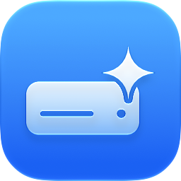
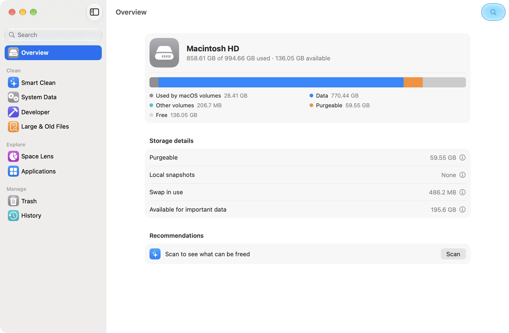
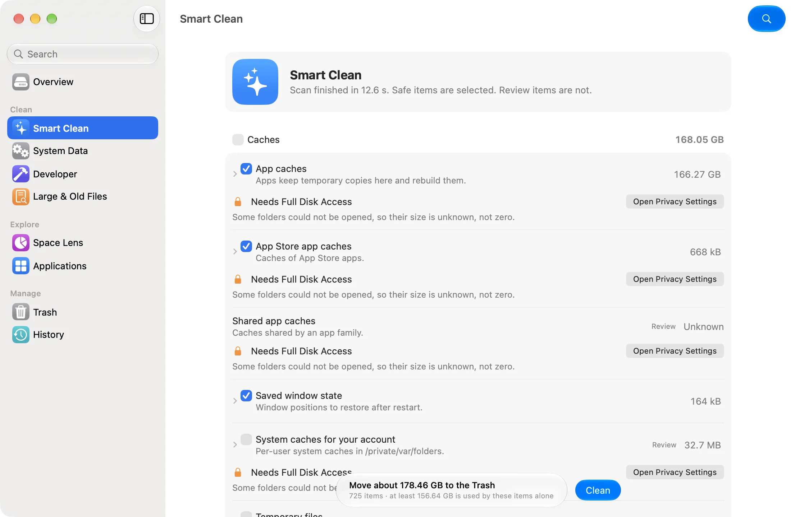
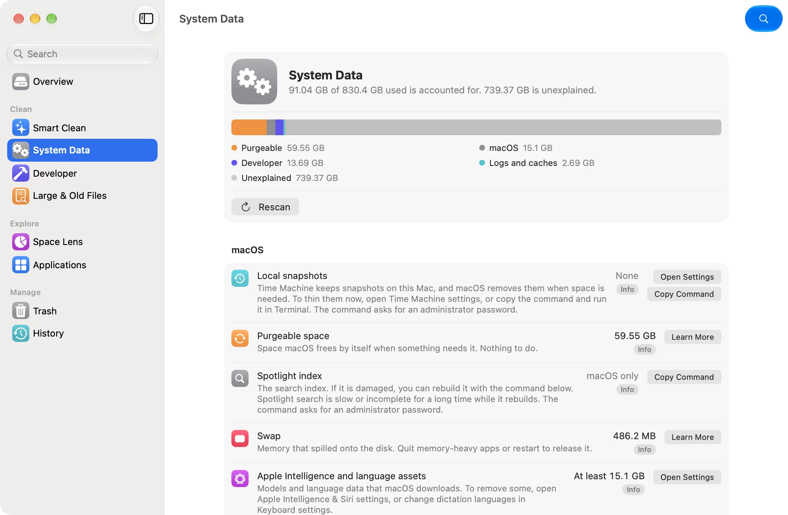
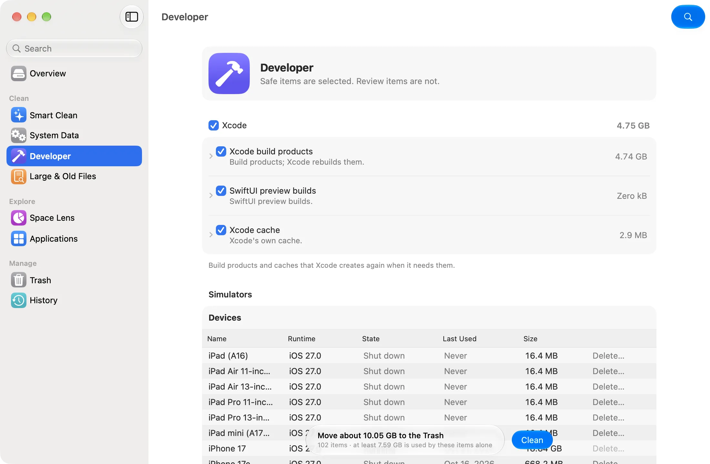
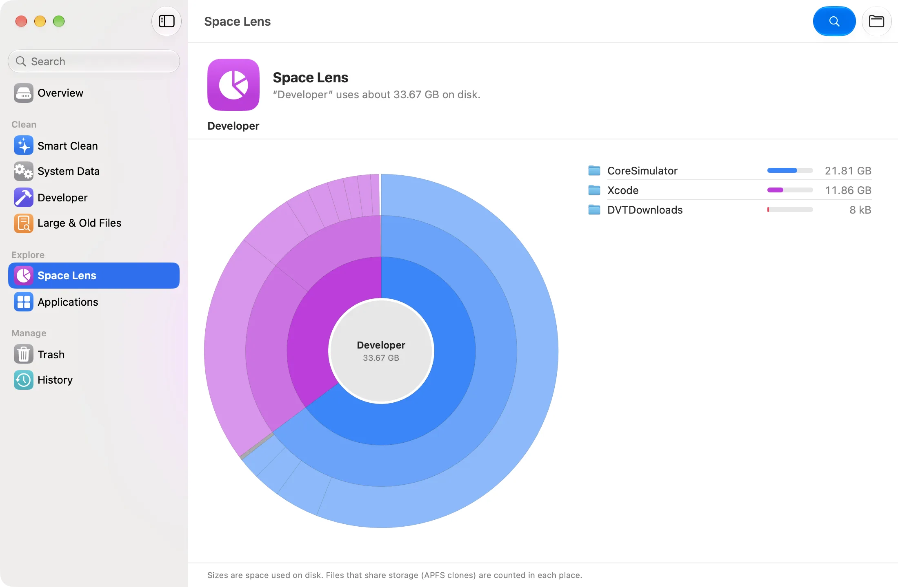
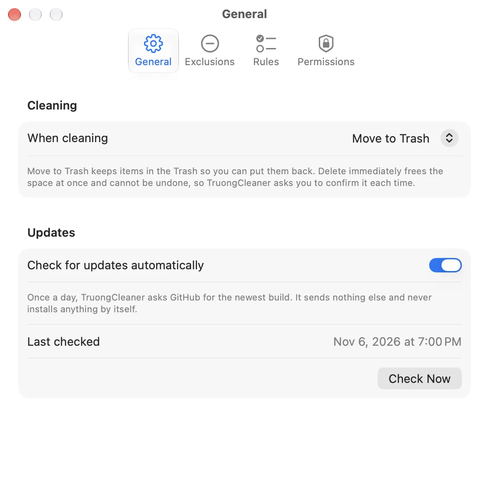

<div align="center">



# TruongCleaner

A lightweight native Mac app that shows what is really inside "System Data" and frees space safely.

[Download latest DMG](https://github.com/iant4093/TruongCleaner/releases/latest/download/TruongCleaner.dmg) · [Releases](https://github.com/iant4093/TruongCleaner/releases) · [Build status](https://github.com/iant4093/TruongCleaner/actions) · [Report an issue](https://github.com/iant4093/TruongCleaner/issues)

[](https://github.com/iant4093/TruongCleaner/releases/latest/download/TruongCleaner.dmg)


[](https://github.com/iant4093/TruongCleaner/actions/workflows/ci.yml)

</div>

---

Storage settings on a Mac often show a huge "System Data" bar and little else.
TruongCleaner breaks it down: local Time Machine snapshots, the Spotlight index,
caches, logs, Xcode and simulator data, iOS backups, Docker images, Apple
Intelligence assets and more. It cleans what is safe to clean, moves items to
the Trash by default so you can put them back, and shows Apple's own fix for the
parts no app may touch.

> **Version 1.0.** Every push to `main` that passes CI publishes a new build, which
> installed copies can install from Settings.

## Screenshots

Release build on macOS 27, 1100 × 720 window, Light appearance.

<table>
  <tr>
    <td width="50%" valign="top">
      
      <p align="center"><sub><b>Overview</b> · storage bar, purgeable space, snapshots and swap</sub></p>
    </td>
    <td width="50%" valign="top">
      
      <p align="center"><sub><b>Smart Clean</b> · grouped results, Review items unchecked</sub></p>
    </td>
  </tr>
  <tr>
    <td width="50%" valign="top">
      
      <p align="center"><sub><b>System Data</b> · what macOS hides, and the sanctioned fix for each</sub></p>
    </td>
    <td width="50%" valign="top">
      
      <p align="center"><sub><b>Developer</b> · Xcode data, simulators, package caches</sub></p>
    </td>
  </tr>
  <tr>
    <td width="50%" valign="top">
      
      <p align="center"><sub><b>Space Lens</b> · sunburst with drill-down</sub></p>
    </td>
    <td width="50%" valign="top">
      
      <p align="center"><sub><b>Settings</b> · delete mode, exclusions, rules, permissions</sub></p>
    </td>
  </tr>
</table>

## Features

**See where space went**

- Overview: a storage bar like System Settings (macOS volumes, your data, purgeable space, free space) and recommendations
- System Data: each contributor with its size, what it is, and the sanctioned way to reduce it, including commands you can copy for the parts that need an administrator
- Space Lens: a sunburst of any folder, with drill-down and Quick Look
- Large & Old Files: big files you have not changed in a while, in folders you choose
- Applications: uninstall an app together with the files it left in your Library, matched only by the app's ID, never by a guess

**Clean safely**

- Smart Clean for app caches, logs, browser caches, chat and editor caches, and unfinished downloads
- Developer: Xcode build data, device support files, simulators and runtimes (through `xcrun simctl`), Swift packages, npm, Yarn, pnpm, Bun, pip, uv, Cargo, Go, Gradle, Maven, CocoaPods, Homebrew, Docker, and build folders inside your projects
- Moves items to the Trash by default, records every clean, and can put items back; "Free Space Now" empties only what TruongCleaner moved
- Skips anything in use, recently changed, owned by an open app, or protected by macOS, and says why
- Never touches iCloud Drive, Photos libraries, Mail or Messages data, Keychains, password managers or AI-assistant memory

**Native and light**

- SwiftUI with the System Settings look and Liquid Glass controls
- No third-party code, no telemetry; one optional daily check for a newer build, and updates install from Settings with a checksum and signature check
- The scanner reads about 120,000 files a second, 3.8 times as fast as `du`, using under 20 MB of memory on an M3 Max (`docs/EVIDENCE.md`, task 2.6)

## Install

```bash
curl -fsSL https://github.com/iant4093/TruongCleaner/releases/latest/download/install.sh | sh
```

The script downloads the latest build, checks it against `SHA256SUMS` from the
same release, and installs it in Applications. Files fetched with `curl` are not
quarantined, so the app opens without the Gatekeeper prompt (checked on macOS 27).

To use the DMG instead: open it, drag TruongCleaner to Applications, open it once,
then choose **System Settings > Privacy & Security > Open Anyway**. Release builds
are ad-hoc signed, not notarized.

**Full Disk Access is optional.** Without it, TruongCleaner still cleans your own
caches, logs and developer data, and marks the rest "Needs Full Disk Access". Grant
it in System Settings > Privacy & Security > Full Disk Access. Because builds are
ad-hoc signed, macOS may ask again after an update.

Download only from this repository's [Releases](https://github.com/iant4093/TruongCleaner/releases) page.
To check that a download was built by this repository's CI, run
`gh attestation verify TruongCleaner.zip --repo iant4093/TruongCleaner`.

## Tech stack

| Area | Technologies |
|---|---|
| Interface | SwiftUI, Liquid Glass, Swift Charts, Observation; AppKit only for icons, Trash, Finder and panels |
| Scanning | Darwin `getattrlistbulk` with a bounded worker pool, allocated and APFS clone-private sizes, hard-link de-duplication, volume boundaries by file-system ID |
| Cleaning | One safety gate in front of every deletion, `FileManager.trashItem`, JSON Lines history with put-back, fixed owner commands (`xcrun simctl`, `brew`, `docker`, `go`, `pnpm`) |
| Liveness | Running-app checks, open-file detection through `libproc`, "unknown means keep" |
| Quality | SwiftLint, Swift 6 strict concurrency, warnings as errors, Swift Testing, Xcode static analysis, deletion-site check; CodeQL for workflows |
| Delivery | GitHub Actions on the `xcode-27` image, ad-hoc signed arm64 app, DMG, ZIP, install script, SHA-256 checksums, build attestations, external dSYM |

## Build locally

Requires a Mac with **Xcode 27** and macOS 26 or later. No package-manager step.

```bash
bash scripts/build.sh all      # Debug and Release
bash scripts/package.sh        # ad-hoc sign, verify, DMG, ZIP, checksums into dist/
```

Open `TruongCleaner.xcodeproj` and run the `TruongCleaner` scheme to work in Xcode.
The core lives in the local Swift package `Packages/CleanerKit`.

## Tests

```bash
bash scripts/lint.sh                  # pinned SwiftLint, checksum-verified
bash scripts/check-deletion-sites.sh  # no deleting API outside CleanerActions
bash scripts/test.sh package          # Swift Testing for CleanerKit
```

Tests build their own folder trees under `build/` (and attach a small disk image
for Trash tests). They never touch your real files. The app safety rules in
`.kiro/steering/safety.md` (rules 1–16) are covered by tests or by the
deletion-site check, including regression tests for data-loss incidents reported
in other cleaners.

## CI and releases

Pull requests and pushes to `main` run:

1. Workflow lint and security checks (actionlint, shellcheck, zizmor), Gitleaks and CodeQL for workflows.
2. SwiftLint, the deletion-site check and the CleanerKit tests.
3. Debug and Release builds with strict concurrency and warnings as errors, and Xcode static analysis.
4. Signing, verification (arm64, macOS 26.0 minimum, system libraries only, matching dSYM) and packaging.

After all gates pass, pushes to `main` publish a GitHub Release with
`TruongCleaner.dmg`, `TruongCleaner.zip`, `install.sh`, `TruongCleaner.dSYM.zip`
and `SHA256SUMS`, with build provenance attestations. Pull requests never publish.
GitHub Actions are pinned to commit SHAs and checked weekly by Dependabot.

## How it was built

Planning, research, code review and releases were done by an orchestrator agent
(Claude Opus 5.5); implementation tasks were done by builder agents (Claude Sonnet
5.5) from written briefs, each reviewed before merge. The plan, research, rule
catalog, briefs and every measurement are in `docs/`; agent configuration and
hooks are in `.kiro/`.

## Repository layout

```text
.
├── src/TruongCleaner/      App: pages, components, platform glue
├── Packages/CleanerKit/    Core rules, scanner and safe-clean engine, with tests
├── TruongCleaner.xcodeproj/
├── scripts/                Lint, test, build, package, install; hooks/ for agents
├── spikes/                 Wave 0 experiments, never shipped
├── docs/                   Plan, research, rule catalog, UI spec, evidence, briefs
├── .kiro/                  Agent steering, specs, hooks and configs
├── .github/                CI/release workflow and Dependabot
├── AGENTS.md
├── LICENSE                 MIT
└── README.md
```
